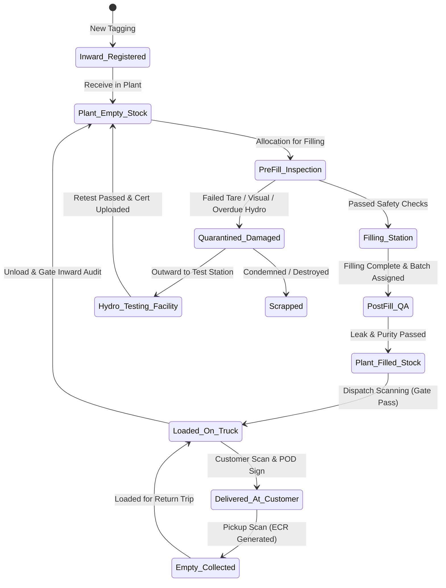

# Core Functional Modules & Business Logic Specification
## Cylinder Tracking Management System (CTMS)

---

## 1. Master Data & Multi-Ownership Ledger

### 1.1 Cylinder Identification & Ownership Classification
Every physical cylinder must be classified by ownership to prevent unlawful rental billing, asset mix-ups, or unauthorized asset seizure.

```
                     +---------------------------------------+
                     |         CYLINDER MASTER ASSET         |
                     +---------------------------------------+
                                         |
         +-------------------------------+-------------------------------+
         |                               |                               |
         v                               v                               v
+------------------+           +------------------+            +------------------+
|   Company Owned  |           |  Customer Owned  |            |   Vendor Owned   |
|      (COC)       |           |   (POC / Party)  |            |      (VOC)       |
+------------------+           +------------------+            +------------------+
| • Asset on books |           | • Customer asset |            | • Third-party    |
| • Rental billed  |           | • Pure refilling |            |   refiller asset |
| • Security dep.  |           | • Zero rental    |            | • Inward/Outward |
| • Full PESO resp |           | • Return to same |            |   reconciliation |
+------------------+           +------------------+            +------------------+
```

1. **Company Owned Cylinders (COC):**
   - Owned by the gas company; capitalized as fixed assets.
   - Issued to clients against a **Security Deposit** and subject to **Daily Rental / Holding Charges** past an agreed grace period.
   - Company is strictly responsible for PESO hydrostatic testing, maintenance, and valve replacements.
2. **Party / Customer Owned Cylinders (POC):**
   - Brought in by the customer solely for refilling.
   - **Crucial Business Rule:** Must *never* be charged cylinder holding rental. Must be returned to the *exact same customer* upon completion of refilling.
   - The system alerts if a customer's cylinder is accidentally dispatched to another client.
3. **Vendor / Principal Owned Cylinders (VOC):**
   - Sourced from upstream bulk manufacturers (e.g., Linde, Air Liquide, Inox Air Products).
   - Inwarded on lease/holding and tracked for vendor rental liabilities and reconciliation.

### 1.2 Extended Asset Structures: Quads, Manifolds, Pallets & Skids
Industrial and medical gas operations frequently bundle cylinders into grouped handling units:
- **Cylinder Banks / Quads (Manifold Bundles):** 16, 24, or 48 interconnected cylinders mounted in a certified steel frame with a single filling/discharge manifold.
- **Master-Child Relationship:** Scanning the single RFID tag or QR code of the Quad automatically checks in/out all child cylinders associated with that bundle, while maintaining individual cylinder hydrostatic test records.
- **Pallets & Trolleys:** Mobile transport units tracked as serialized secondary assets to prevent logistics cage shrinkage.

---

## 2. Cylinder Lifecycle State Machine

A cylinder exists in one deterministic state at any given moment. State transitions are strictly enforced via barcode/RFID scan events:



### State Definitions & Transition Guardrails:
1. **`PLANT_EMPTY`**: Empty cylinder residing in the yard awaiting sorting/filling.
2. **`UNDER_INSPECTION`**: Pre-filling verification (Tare weight check, visual rust/thread check, PESO hydro-testing validity check).
3. **`QUARANTINED`**: Flunked pre-fill or post-fill inspection. **Hard interlock prevents dispatch.**
4. **`FILLING`**: Connected to manifold. Assigned to `FillingBatchID`.
5. **`PLANT_FILLED`**: Tested, labeled, and staged in the dispatch bay.
6. **`IN_TRANSIT_OUTWARD`**: Scanned onto a truck with a linked `DeliveryChallanID` and `TripID`.
7. **`CUSTOMER_HELD`**: Transferred to customer custody upon digital Proof of Delivery (POD). Holding counter activates.
8. **`IN_TRANSIT_INWARD`**: Collected empty from customer, logged under `ElectronicCylinderReceiptID` (ECR).
9. **`MAINTENANCE_TESTING`**: Sent out to PESO approved testing station for hydro-stretch test, shot blasting, or neck valve change.
10. **`SCRAPPED`**: Condemned per PESO guidelines; serial number retired from active fleet.

---

## 3. Plant & Filling Station Operations Module

### 3.1 Pre-Fill Safety Validation Engine
Before any cylinder can be mounted to the gas filling manifold, the operator must scan its tag. The system performs automatic real-time safety validations:
- **Test-Due Enforcement (Zero Tolerance):**
  - If `CurrentDate >= HydroTestDueDate`, the app displays a high-visibility RED screen and locks the cylinder from batch assignment.
  - Alert: *"CYLINDER #AR-489 OVERDUE FOR HYDROSTATIC TESTING SINCE 14-OCT-2026. ROUTE TO TEST YARD."*
- **Gas Type Contamination Guard:**
  - Prevents filling combustible gas (e.g., Hydrogen, Acetylene) into an Oxygen cylinder, or Industrial Argon into Medical Oxygen cylinders.
- **Tare Weight Loss Tolerance:**
  - If actual empty tare weight deviates from stamped tare weight by >5% (indicative of internal wall erosion or heavy internal scale), cylinder is flagged for wall thickness ultrasonic test.

### 3.2 Filling Batch & Purity Logging
- **Batch Master:** Grouping of 20 to 100 cylinders filled simultaneously on a single manifold cycle.
- **Captured Telemetry:**
  - `BatchNumber`, `GasType`, `PurityPercentage` (e.g., 99.999% Ultra-High Purity Nitrogen), `FillingPressure` (Bar/PSI), `AmbientTemperature`, `OperatorID`, `AnalysisLabReportPDF`.
- **Medical Oxygen Compliance:** Mandatory batch traceability for medical oxygen (IP standard) requiring lot certificates attached to delivery challans for hospital audits.

---

## 4. Dispatch, Trip Management & Logistics Reconciliation

```
[ Plant Yard ] 
       | (RFID Portal / Barcode Scan)
       v
[ Gate-Pass & Loading Manifest ] ===> Driver leaves plant with 120 Filled Cylinders
       |
       v (Route Deliveries & Pickups via Driver App)
+-------------------------------------------------------------------------+
| Stop 1: Hospital A   --> Delivered 20 Filled  | Collected 15 Empty      |
| Stop 2: Fabricator B --> Delivered 30 Filled  | Collected 30 Empty      |
| Stop 3: Foundry C    --> Delivered 40 Filled  | Collected 35 Empty      |
+-------------------------------------------------------------------------+
       |
       v (Truck returns to Gate)
[ Gate Inward Audit & Trip Reconciliation ]
       • Total Outward: 120 Filled
       • Delivered: 90 Filled | Undelivered / Retained: 30 Filled
       • Empties Collected: 80 Empty
       • Expected Truck Balance: 30 Filled + 80 Empty = 110 Cylinders
       • Unaccounted Variance: 10 Cylinders MISSING -> Instant Driver Discrepancy Alert
```

### 4.1 Trip Loading Manifest & Gate-Pass
- System matches physical cylinders scanned onto the vehicle against approved Sales Orders in Zoho CRM / Zoho Books.
- Generates official GST E-Way Bill and Outward Gate-Pass with full list of serialized cylinder numbers.

### 4.2 Trip Reconciliation Algorithm
Upon vehicle return, gate staff perform an inward scan. The reconciliation engine enforces:
$$\text{Closing Truck Balance} = \text{Opening Dispatched} - \text{Delivered} + \text{Collected Empties}$$
Any discrepancy triggers an immediate supervisor hold before the driver is cleared for the day.

---

## 5. Driver Mobile Application & Digital Proof of Delivery (POD)

### 5.1 Architecture & Usability Features
- **Offline-First Mode:** Drivers operating in remote industrial zones, basement hospital manifolds, or rural highways can complete drop-offs and pickups without internet connectivity. Transactions queue locally in encrypted SQLite and sync automatically upon signal restoration.
- **High-Velocity Scanning:** Supports continuous camera scan (0.5s per code) and BLE Bluetooth UHF RFID sleds (scanning an entire truck bay in seconds).

### 5.2 Delivery Workflow & Non-Repudiation
1. **Drop-off Scan (Filled):** Scans cylinder IDs delivered to customer.
2. **Pickup Scan (Empty):** Scans empties retrieved. The system validates whether the returned cylinders were originally company-owned or customer-owned.
3. **Instant Discrepancy Resolution:**
   - If customer claims they received 10 cylinders but driver only scans 9, the app prevents completion until reconciled.
   - If a cylinder collar is damaged or valve is bent, driver captures a photo and tags condition as `DAMAGED_VALVE_PENALTY`.
4. **Verification:**
   - Customer representative signs on the mobile screen (e-Signature) OR confirms via dynamic 4-digit SMS/WhatsApp OTP sent to authorized phone number.
   - GPS coordinate and timestamp watermarking embedded into the generated PDF.
5. **Output Documents:**
   - **Electronic Delivery Challan (e-DC)**
   - **Electronic Cylinder Receipt (e-CR)**
   - Instant WhatsApp dispatch to customer purchase officer and finance desk.

---

## 6. Automated Rental, Holding Charges & Deposit Engine

```
Customer receives 20 Oxygen Cylinders on 01-Nov-2026.
Agreed Contract Terms in Zoho CRM:
  • Free Grace Period: 15 Days
  • Slab 1 (Days 16 - 30): ₹ 10.00 / cylinder / day
  • Slab 2 (Days 31 - 60): ₹ 25.00 / cylinder / day
  • Slab 3 (Days 61+):     ₹ 50.00 / cylinder / day (Over-holding penalty)
  • Lost Asset Trigger: 90 Days -> Automated Invoice for Cylinder Replacement Cost (₹ 12,000)
```

### 6.1 Calculation Logic (Daily Holding Matrix)
The engine runs as a daily midnight cron job:
For every customer, the system evaluates all active cylinders held:
$$\text{HoldingDays} = \text{CurrentDate} - \text{DeliveryDate}$$
$$\text{BillableDays} = \max(0, \text{HoldingDays} - \text{ContractGraceDays})$$

### 6.2 Rental Rate Configuration Models
1. **Flat Daily Rental:** Fixed rate per day per cylinder category.
2. **Tiered Progressive Slabs (ctmsgas.com model):** Progressively higher rates to penalize hoarding and encourage fast empty turnaround.
3. **Cylinder Exchange Allowance (Ratio Rule):** Free holding provided customer returns 1 empty for every 1 filled delivered within $X$ days.
4. **Monthly Flat Fee vs Transactional:** Monthly cylinder lease fee with overage charges.

### 6.3 Automated Zoho Books Invoicing
- At the end of the billing cycle (e.g., 1st of every month), the engine calculates accumulated holding fees per customer.
- Summarizes total billable cylinder-days by gas type.
- Automatically generates draft or approved **Sales Invoices in Zoho Books** with attached itemized breakdown PDF listing every cylinder serial number and exact holding duration.

### 6.4 Security Deposit Management
- Track deposits per cylinder type (e.g., ₹ 4,500 for Oxygen 47L, ₹ 8,000 for Argon, ₹ 35,000 for Dissolved Acetylene).
- **Deposit Refund / Ledger Adjustment:**
  - When customer closes account or returns excess inventory, deposits are refunded or offset against outstanding gas and rental invoices in Zoho Books.

---

## 7. PESO, Statutory Testing & Safety Compliance Module

### 7.1 Compliance Tracking Specifications
Under the Gas Cylinders Rules (PESO/SMPV):
- **Hydrostatic Stretch Testing:** Seamless steel cylinders must undergo hydraulic volumetric expansion testing every 5 years.
- **Tare Weight Loss Inspection:** Stamped tare weight must be verified. Loss of more than 5% requires wall thickness derating or scrapping.
- **Valve Overhaul & Replacement:** Inspection and replacement history logged per cylinder collar.
- **Color Coding Compliance:** Cylinders painted according to statutory color codes (Oxygen: Black body, White shoulder; Nitrogen: Grey body, Black shoulder; Nitrous Oxide: French Blue body, etc.).

### 7.2 Safety Audit & Inspection Reports
- **1-Click PESO Audit Export:** Instantly generates statutory inspection registers in official format:
  - Manufacturer Name & Serial Number
  - Specification (IS 7285 / DOT 3AA)
  - Water Capacity (Litres) & Working Pressure ($kgf/cm^2$)
  - Last Test Date & Due Date
  - Hydro Test Certificate Number & PESO Approved Testing Station ID
- **Scrap / Condemnation Protocol:**
  - De-valving, crushing/cutting documentation, and PESO de-registration certificates.
