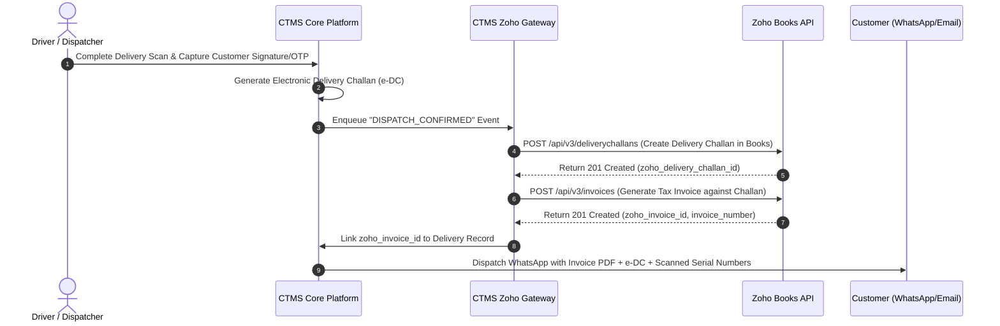

# Zoho Ecosystem Integration Specification
## Architecture, Data Mapping, Webhook Pipelines & API Blueprints

---

## 1. Overview of the Zoho Integration Architecture

The integration between **Cylinder Tracking Management System (CTMS)** and the **Zoho Cloud Suite** provides a bidirectional, real-time bridge uniting physical operations with enterprise financial and customer management.

```
+--------------------------------------------------------------------------------------------------+
|                                    CTMS OPERATIONAL PLATFORM                                     |
|                                                                                                  |
| [Scan Events]       [Filling Batches]     [Trips & PODs]       [Holding Engine]  [PESO Safety]   |
+--------+-------------------+---------------------+--------------------+----------------+---------+
         |                   |                     |                    |                |
         | Outward/Inward    | Item Specs          | Proof of Delivery  | Monthly Rent   | Safety  |
         v                   v                     v                    v                v         |
+--------------------------------------------------------------------------------------------------+
|                                 CTMS ZOHO SYNC GATEWAY (INTEGRATION LAYER)                       |
|                                                                                                  |
| • OAuth 2.0 Token Manager (Auto-Refresh)         • Idempotency & De-duplication Store (Redis)   |
| • BullMQ Distributed Asynchronous Sync Queues    • Rate Limit & Throttling Throttler (Zoho API)  |
| • Bi-directional Webhook Handler & Transformer   • Dead-Letter Queue & Conflict Resolution Log   |
+--------+-------------------+---------------------+--------------------+----------------+---------+
         |                   |                     |                    |                |
         v                   v                     v                    v                v
+-------------------+ +-------------------+ +-------------------+ +--------------------+ +---------+
|    ZOHO BOOKS     | |  ZOHO INVENTORY   | |     ZOHO CRM      | |   ZOHO ANALYTICS   | |ZOHO SIGN|
|                   | |                   | |                   | |                    | |         |
| • Customers/Party | | • Gas Item Master | | • Customer Accs   | | • Turnaround BI    | |• Rental |
| • Sales Invoices  | | • Multi-Warehouse | | • Agreed Slabs    | | • Fleet Revenue    | |  SLAs   |
| • Delivery Challan| | • Stock Adjust-   | | • Holding Quota   | | • Shrinkage Loss   | |• Deposit|
| • Rental Invoices | |   ments (Volume)  | | • Service Tickets | | • Customer Churn   | |  Pledges|
| • Security Deposit| | • Composite Items | | • Contact Persons | | • Utilization Rate | |         |
| • Credit/Debit Not| |                   | |                   | |                    | |         |
+-------------------+ +-------------------+ +-------------------+ +--------------------+ +---------+
```

---

## 2. Zoho Books Integration

Zoho Books is the primary financial ledger. CTMS synchronizes operational movements into financial transactions and captures payment status.

### 2.0 Core Document Triad for Cylinder Lifecycle Tracking

The relationship between physical gas cylinder movements and Zoho Books transactions follows a strict, non-negotiable semantic triad:

```
+---------------------------------------------------------------------------------------------------+
|                                 CTMS <-> ZOHO BOOKS DOCUMENT TRIAD                                |
+---------------------------------------------------------------------------------------------------+
| Zoho Document Type         | CTMS Lifecycle Event             | Operational & Accounting Semantics|
+----------------------------+----------------------------------+-----------------------------------+
| **Sales Orders**           | **CYLINDER IN**                  | Customer refill demand, intake of |
| (`/api/v3/salesorders`)    | (Empty Intake, POC Intake,       | empty cylinders returning to plant|
|                            |  Customer Refill Request)        | or driver pickup; triggers queue. |
+----------------------------+----------------------------------+-----------------------------------+
| **Tax Invoices**           | **CYLINDER OUT**                 | Outward delivery of filled gas    |
| (`/api/v3/invoices`)       | (Filled Dispatches, Consumable   | cylinders to customer premises;   |
|                            |  Gas Product Sales)              | debits stock, posts revenue & GST.|
+----------------------------+----------------------------------+-----------------------------------+
| **Stock Delivery Challans**| **CYLINDER ON SECURITY OR RENT** | Returnable container bailment     |
| (`/api/v3/deliverychallans`| (Asset Custody, Security Deposit | under GST Rule 55; custody loan;  |
|  type: supply_on_approval) |  Ledger, Rental Agreement Clock) | starts/stops daily holding clock. |
+---------------------------------------------------------------------------------------------------+
```

1. **Sales Orders as "Cylinder IN":**
   - Whenever empty cylinders are collected from a customer or Party-Owned Cylinders (POC) arrive at the plant gate for refilling, a **Sales Order** is created/referenced in Zoho Books.
   - It captures the customer's refill demand and serves as the inbound manifest for cylinders brought **IN** to the plant.
   - Custom field: `cf_serialized_cylinders_inward`.

2. **Invoices as "Cylinder OUT":**
   - When filled cylinders are dispatched and delivered to the customer, a **Tax Invoice** is generated in Zoho Books.
   - This records the actual sale of consumable gas product ($m^3$ or $kg$) and documents the cylinders going **OUT** of the plant to the customer.
   - Custom field: `cf_serialized_cylinders_outward`.

3. **Stock Delivery Challan as "Cylinder on Security or Rent":**
   - High-pressure gas cylinders are reusable capital assets, not consumables. Under GST Rule 55, containers supplied on a returnable basis (on refundable **Security Deposit** or under a **Rental / Loan Agreement**) are issued on a **Stock Delivery Challan**.
   - Ownership remains with the gas company; it tracks physical custody and starts/stops the holding days timer for rental calculation.
   - Custom fields: `cf_serialized_cylinders_on_rent`, `cf_security_deposit_liability_ref`.

### 2.1 Master Data Synchronization
- **Customer / Contact Sync (Bi-directional):**
  - When a customer is created or edited in Zoho Books, a webhook triggers CTMS to update the local Customer Master.
  - CTMS stores `zoho_contact_id` for all operations.
  - Mapped Fields:
    - `contact_id` $\leftrightarrow$ `zoho_customer_id`
    - `company_name` $\leftrightarrow$ `customer_name`
    - `gst_no` $\leftrightarrow$ `gstin`
    - `billing_address` $\leftrightarrow$ `billing_address`
    - `custom_fields.cylinder_credit_limit` $\leftrightarrow$ Max allowed company-owned cylinders.
    - `custom_fields.free_grace_days` $\leftrightarrow$ Agreed rent-free days.

- **Item Master Sync:**
  - Gas items (e.g., "Oxygen Medical 7.0 m³", "Nitrogen High Purity 47L Refill") are mapped via `zoho_item_id`.
  - Service Items for Rental: "Cylinder Daily Holding Charge - Oxygen", "Cylinder Daily Holding Charge - Argon", "Cylinder Loss Replacement Penalty".

---

### 2.2 Operational Document Flow



#### A. Gas Refill Delivery $\rightarrow$ Delivery Challan & Sales Invoice
1. **Trigger:** Driver completes delivery; customer signs POD on mobile app.
2. **Payload to Zoho Books (`/api/v3/deliverychallans`):**
   - References `customer_id`.
   - Line items indicate gas type, unit volume/weight, rate, and GST.
   - Custom Field on Challan: `cf_serialized_cylinders`: Formatted comma-separated list of delivered cylinder serial numbers (e.g., `OX-10492, OX-10495, OX-10512`).
   - Attached Files: Auto-attaches signed POD PDF and gate-pass image to the Zoho Books record.
3. **Invoice Generation:** Converts Challan to Sales Invoice (or posts directly as Tax Invoice depending on client's tax workflow).

#### B. Monthly Cylinder Holding & Rental Billing $\rightarrow$ Automated Invoicing
1. **Trigger:** Scheduled midnight job on the 1st of every month (or custom billing frequency per customer).
2. **Calculation:**
   - Evaluates accumulated billable cylinder-days for each customer over the billing cycle.
3. **Zoho Books Invoice Payload (`/api/v3/invoices`):**
   ```json
   {
     "customer_id": "982000000184291",
     "date": "2026-11-01",
     "due_date": "2026-11-15",
     "reference_number": "RENT-OCT-2026-CUST44",
     "line_items": [
       {
         "item_id": "982000000094112",
         "name": "Cylinder Rental Charges - Oxygen 47L",
         "description": "Rental for 14 cylinders held past 15 grace days (Total 210 billable cylinder-days @ ₹10/day)",
         "rate": 10.0,
         "quantity": 210,
         "tax_id": "982000000000089"
       },
       {
         "item_id": "982000000094115",
         "name": "Cylinder Rental Charges - Argon 47L",
         "description": "Rental for 5 cylinders held past 10 grace days (Total 75 billable cylinder-days @ ₹25/day)",
         "rate": 25.0,
         "quantity": 75,
         "tax_id": "982000000000089"
       }
     ],
     "custom_fields": [
       {
         "label": "Audit Breakdown URL",
         "value": "https://app.ctmsgas.com/reports/rental-audit/RNT-881273"
       }
     ]
   }
   ```
4. **Itemized Audit Attachment:** CTMS automatically attaches a detailed statement PDF containing a day-by-day table of each cylinder serial number held, delivery date, return date, and calculated rent.

#### C. Cylinder Security Deposit Accounting
- When deposits are collected from customers:
  - Posted in Zoho Books as **Customer Advance** or linked to a Current Liability Ledger account (`Cylinder Security Deposits Liability`).
  - CTMS records the specific cylinder serial numbers tied to the deposit receipt.
- When cylinders are returned and deposit is refunded:
  - If undamaged: Generates a Payment Refund or Credit Note in Zoho Books.
  - If damaged / lost: Generates a Debit Note / Invoice for cylinder replacement, offsetting against the security deposit liability.

---

## 3. Zoho Inventory Integration

In gas distribution, the gas inside the cylinder is a *consumable inventory item* (measured in $m^3$, $kg$, or Litres), while the cylinder shell itself is a *reusable serialized asset container*. Zoho Inventory handles stock of the contents, while CTMS handles the container fleet.

### 3.1 Gas Inventory & Warehouse Depots
- **Multi-Warehouse Mapping:**
  - CTMS Plants, Filling Depots, and Mobile Delivery Trucks are represented as distinct **Warehouses** in Zoho Inventory:
    - `Main Bottling Plant (Warehouse 1)`
    - `North Depot (Warehouse 2)`
    - `Truck MH-04-AB-1234 (Mobile Warehouse 3)`
- **Stock Transfers:**
  - When a truck is loaded at the plant, CTMS triggers a **Transfer Order** in Zoho Inventory moving bulk gas units from `Main Bottling Plant` to `Truck MH-04-AB-1234`.
  - When the driver delivers to the customer, Zoho Inventory records stock reduction from that specific mobile warehouse.
- **Gas Refill Reconciliation & Filling Losses:**
  - Pre-fill gas evacuation / residual blow-off and manifold filling losses are calculated in CTMS and posted as **Inventory Adjustments** in Zoho Inventory to reconcile liquid bulk cryogenic storage against filled cylinder volume.

---

## 4. Zoho CRM Integration

Zoho CRM powers client contract terms, credit allocations, and relationship workflows.

### 4.1 Account & Agreement Module
- **Custom Contract Fields synced to CTMS:**
  - `Agreed_Free_Grace_Days`: Number of rent-free days per delivery (e.g., 7, 15, 30 days).
  - `Rental_Slab_Tier`: Tier 1 (Flat ₹15), Tier 2 (Progressive ₹10/₹20/₹40), or Custom Contract.
  - `Max_Cylinder_Holding_Quota`: Maximum number of company cylinders permitted simultaneously.
  - `Deposit_Amount_Per_Cylinder`: Standard deposit schedule per gas type.
  - `POC_Refill_Agreement`: Flag indicating customer is authorized for refilling customer-owned cylinders (POC).

### 4.2 Dynamic Live Balance Widgets
- Inside Zoho CRM Account view, an embedded **Zoho CRM Widget (Catalyst / iFrame)** displays live data from CTMS:
  - Active Cylinders in Custody (by gas type).
  - Cylinders Approaching Grace Period Expiry (Alert state).
  - Longest-held Cylinder ID and current holding duration.
  - Total Unbilled Rental Accrued month-to-date.
  - Total Security Deposit on Hand.

### 4.3 Automated SLA & Escalation Tickets (Zoho Desk / CRM Cases)
- If a customer holds a cylinder for $>60$ days without movement:
  - CTMS triggers a Webhook creating a High-Priority Task / Case in Zoho CRM for the account manager: *"Unreturned Cylinder Warning: Customer ABC holds 12 Oxygen cylinders past 60 days. Arrange recovery."*

---

## 5. Zoho Analytics (Business Intelligence & Asset Turnaround)

Data from CTMS is streamed into Zoho Analytics via periodic data warehouse sync (PostgreSQL to Zoho Analytics Workspace) to provide executive and operational dashboards.

```
+---------------------------------------------------------------------------------------------------+
|                              EXECUTIVE CYLINDER FLEET BI DASHBOARD                                |
+---------------------------------------------------------------------------------------------------+
|  [ Total Active Fleet ]      [ Fleet Utilization ]      [ Avg Turnaround Cycle ]   [ Idle in Yard ]|
|       14,500 Units                  84.2%                       14.2 Days              820 Units  |
+---------------------------------------------------------------------------------------------------+
|  [ Revenue from Gas ]        [ Revenue from Rental ]    [ Shrinkage / Missing ]   [ Overdue Test ]|
|       ₹ 1,84,50,000                 ₹ 24,10,000                 18 Units (0.12%)       42 Units   |
+---------------------------------------------------------------------------------------------------+
```

### Key Performance Indicators (KPIs) in Zoho Analytics:
1. **Cylinder Turnaround Time (TAT):** Average days taken from Plant Dispatch $\rightarrow$ Customer Delivery $\rightarrow$ Empty Collection $\rightarrow$ Plant Return $\rightarrow$ Refill.
2. **Customer Holding Aging Analysis:** Aging buckets ($<15$ days, $16-30$ days, $31-60$ days, $61-90$ days, $>90$ days).
3. **Fleet Utilization Rate:** Ratio of cylinders in rotation/generating revenue vs idle in plant yard.
4. **Customer Profitability Matrix:** Comparing margin on gas consumed against asset opportunity cost of cylinders tied up at the client's site.
5. **Driver Route Efficiency:** Cylinders delivered and retrieved per kilometer driven.

---

## 6. Zoho Sign Integration (Legal Pledges & Rental SLAs)

- **Cylinder Bailment & Deposit Agreements:**
  - When onboarding a new customer or issuing high-value cryogenic liquid cylinders (Dura Cylinders / Dewars), an agreement is generated with serialized asset IDs.
  - CTMS sends document templates to **Zoho Sign** requesting digital signatures from the client's authorized director/signatory before first dispatch.
- **Lost Asset Liability Acknowledgement:**
  - Driver app prompts customer to sign digital condition reports or lost asset liability acknowledgments directly through integrated Zoho Sign flows.

---

## 7. Technical Integration Details: Webhooks, Auth & Security

### 7.1 Zoho OAuth 2.0 Management
- CTMS maintains a secure service-to-service OAuth 2.0 worker with `refresh_token` persistence.
- Automatic token rotation before expiry (`expires_in: 3600`).
- **Required Zoho OAuth Scopes:**
  - `ZohoBooks.fullaccess.all`
  - `ZohoInventory.fullaccess.all`
  - `ZohoCRM.modules.ALL`
  - `ZohoAnalytics.data.all`
  - `ZohoSign.documents.ALL`

### 7.2 Webhook Handling & Reliability Architecture
- **Inbound Webhooks from Zoho:**
  - Endpoint: `https://api.ctmsgas.com/v1/integrations/zoho/webhook`
  - Validated via cryptographic HMAC SHA-256 signature verification in HTTP header `X-Zoho-Signature`.
  - Processed asynchronously via Redis BullMQ to prevent HTTP timeout during bulk operations.
- **Outbound Webhooks from CTMS to Zoho:**
  - Guaranteed at-least-once delivery with exponential backoff retry (up to 5 attempts).
  - Idempotency key generated per operational transaction (`Idempotency-Key: evt_disp_90821_v1`) to prevent duplicate invoice or challan creation.
