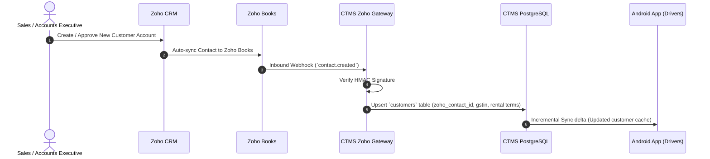
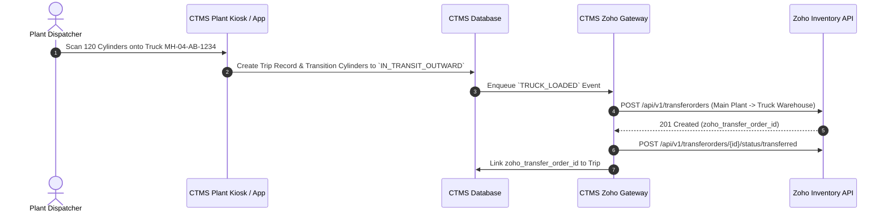
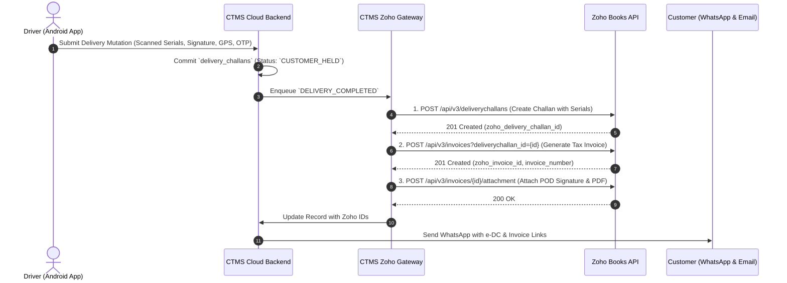
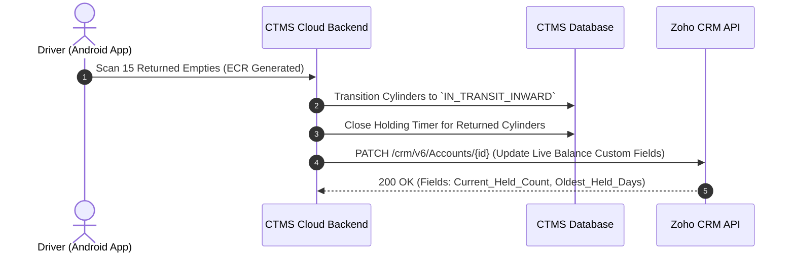
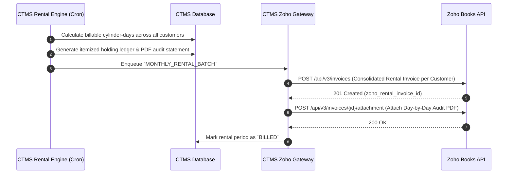
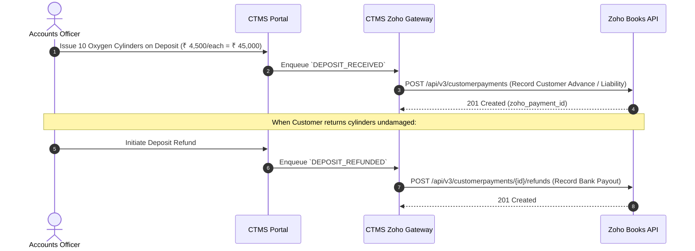

# Zoho API Architecture, Interactions & Payload Specification
## Complete Integration Blueprint for Zoho Books, Inventory, CRM, Analytics & Sign

---

## 1. System Architecture Plan

The Zoho Integration Gateway acts as a resilient, asynchronous, and idempotent middleware between the physical operations captured in CTMS (Native Android App and Plant Kiosks) and the Zoho Cloud Suite.

```
       +-------------------------------------------------------------+
       |               CTMS NATIVE ANDROID CLIENT (KOTLIN)           |
       |  • Offline Room DB   • CameraX QR / BLE RFID   • Digital POD|
       +------------------------------+------------------------------+
                                      | HTTPS (Batched Outbox Mutations)
                                      v
       +-------------------------------------------------------------+
       |                   CTMS CORE API BACKEND                     |
       |  • Ingest & State Machine Engine     • Event Ledger (Postgres)|
       |  • Pre-Fill Safety Validator         • Holding/Rental Engine  |
       +------------------------------+------------------------------+
                                      | Enqueue Sync Jobs
                                      v
       +-------------------------------------------------------------+
       |               ZOHO INTEGRATION GATEWAY LAYER                |
       |  +-------------------------------------------------------+  |
       |  | Redis BullMQ Distributed Queues:                      |  |
       |  |  • `zoho-books-delivery-queue`                        |  |
       |  |  • `zoho-books-rental-queue`                          |  |
       |  |  • `zoho-inventory-transfer-queue`                    |  |
       |  |  • `zoho-crm-sync-queue`                              |  |
       |  +-------------------------------------------------------+  |
       |  | Gateway Services:                                     |  |
       |  |  • OAuth 2.0 Token Manager (Auto-Rotation)            |  |
       |  |  • Distributed Idempotency Enforcer (Redis SETNX)     |  |
       |  |  • Rate Limiter & Throttler (Leaky Bucket: 80 req/min)|  |
       |  |  • Payload Serializer & Custom Field Mapper           |  |
       |  |  • Dead-Letter Queue (DLQ) & Alerting                 |  |
       |  +-------------------------------------------------------+  |
       +------------------------------+------------------------------+
                                      | HTTPS REST APIs / OAuth 2.0
                                      v
       +-------------------------------------------------------------+
       |                      ZOHO CLOUD SUITE                       |
       |  +----------------+  +----------------+  +----------------+ |
       |  |   Zoho Books   |  | Zoho Inventory |  |    Zoho CRM    | |
       |  | (Challan, Inv, |  | (Multi-Ware-   |  | (Accounts, SLAs| |
       |  |  Deposits)     |  |  house, Gases) |  |  Quotas, Deals)| |
       |  +----------------+  +----------------+  +----------------+ |
       |  +----------------+  +----------------+  +----------------+ |
       |  | Zoho Analytics |  |   Zoho Sign    |  |   Zoho Flow    | |
       |  | (BI, TAT, Fleet|  | (Digital Bail- |  | (Inbound Web-  | |
       |  |  Turnaround)   |  |  ment Pledges) |  |  hook Routing) | |
       |  +----------------+  +----------------+  +----------------+ |
       +-------------------------------------------------------------+
```

### 1.1 Architecture Non-Negotiables
1. **Asynchronous Isolation:** Operational workflows on the Android mobile app or plant gate must *never* block waiting for Zoho API responses. All events are committed locally to PostgreSQL and dispatched asynchronously via Redis queues.
2. **Idempotency Enforcement:** Every outward request to Zoho includes an explicit `Idempotency-Key` formed as `ctms_{aggregate_type}_{id}_{version}` (e.g. `ctms_dc_9921_v1`). Zoho or the gateway prevents double-posting if retried.
3. **Rate Limit Shielding:** Zoho Books limits API requests to 100 calls/minute per organization. The integration gateway runs a leaky-bucket rate limiter capped at 80 calls/minute, buffering bursts during shift changeover.
4. **Resilient Retry Policy:** Network or HTTP 5xx errors trigger exponential backoff retry at intervals of 30s, 2m, 10m, 30m, and 2h before escalation to the Dead-Letter Queue (DLQ).

---

## 2. API Interactions Plan (Sequence Workflows)

---

### Interaction 1: Customer Onboarding & Master Sync
Synchronizes customer profiles, tax identifiers, credit quotas, and rental terms.



---

### Interaction 2: Outward Vehicle Loading & Stock Transfer
Moving cylinders from the Bottling Plant to a Delivery Truck.



---

### Interaction 3: Delivery Confirmation, e-DC & Invoicing
Driver completes delivery at customer premises with offline POD.



---

### Interaction 4: Empty Cylinder Collection (ECR) & Holding Credit
Driver retrieves empty cylinders from customer.



---

### Interaction 5: Monthly Rental Invoicing Engine
Automated midnight billing for cylinder holding past grace periods.



---

### Interaction 6: Security Deposit Collection & Refund
Accounting for refundable cylinder deposits under current liabilities.



---

## 3. Payload Plan & Field Mapping Specifications

### 3.0 The Core Zoho Document Triad Mapping
- **Sales Orders (`salesorders`):** **CYLINDER IN** (Customer refill demand, inward intake of empties & POC cylinders).
- **Tax Invoices (`invoices`):** **CYLINDER OUT** (Filled gas cylinder delivery & consumable gas sales).
- **Stock Delivery Challans (`deliverychallans`):** **CYLINDER ON SECURITY OR RENT** (Returnable container bailment under GST Rule 55 / security deposits / rental loan agreements).

---

### 3.1 Zoho Books: Sales Order (Cylinder IN — Refill Intake & Empty Returns)
- **Endpoint:** `POST https://books.zoho.com/api/v3/salesorders`
- **Purpose:** Records customer cylinder intake into the plant or driver vehicle (empty cylinders collected, Party-Owned Cylinders [POC] received for refilling, or pre-orders). Acts as the authoritative commercial demand document for inward cylinders.

#### Headers
```http
Authorization: Zoho-oauthtoken 1000.a1b2c3d4e5f6g7h8i9j0...
X-com-zoho-books-organizationid: 789102931
Content-Type: application/json;charset=UTF-8
Idempotency-Key: ctms_so_2026_004812_v1
```

#### Request Payload
```json
{
  "customer_id": "982000000184291",
  "salesorder_number": "SO-2026-004812",
  "date": "2026-11-01",
  "reference_number": "ECR-20261101-14",
  "line_items": [
    {
      "item_id": "982000000094112",
      "name": "Medical Oxygen Refill 7.0 m3",
      "description": "Refilling service for 10 inbound cylinders",
      "rate": 350.00,
      "quantity": 10,
      "unit": "cyl",
      "tax_id": "982000000000089",
      "warehouse_id": "982000000819201"
    }
  ],
  "custom_fields": [
    {
      "api_name": "cf_cylinder_direction",
      "value": "CYLINDER_IN"
    },
    {
      "api_name": "cf_serialized_cylinders_inward",
      "value": "OX-47-0401, OX-47-0412, OX-47-0419, OX-47-0422, OX-47-0430, OX-47-0435, OX-47-0441, OX-47-0450, AR-47-0081, AR-47-0085"
    },
    {
      "api_name": "cf_intake_type",
      "value": "EMPTY_COLLECTION_AND_REFILL_DEMAND"
    },
    {
      "api_name": "cf_ecr_receipt_number",
      "value": "ECR-20261101-14"
    }
  ],
  "notes": "Cylinders received at plant gate for testing and refilling. Tare weights inspected."
}
```

#### Response (201 Created)
```json
{
  "code": 0,
  "message": "The sales order has been created.",
  "salesorder": {
    "salesorder_id": "982000000994101",
    "salesorder_number": "SO-2026-004812",
    "status": "confirmed",
    "customer_id": "982000000184291",
    "total": 3500.00,
    "created_time": "2026-11-01T08:30:00+0530"
  }
}
```

---

### 3.2 Zoho Books: Stock Delivery Challan (Cylinder on Security or Rent)
- **Endpoint:** `POST https://books.zoho.com/api/v3/deliverychallans`
- **Purpose:** Issues returnable high-pressure gas cylinder containers to customers on refundable Security Deposit or Rental/Loan terms under GST Rule 55 (supply not by way of sale). Tracks asset custody and initiates the rental grace days clock.

#### Headers
```http
Authorization: Zoho-oauthtoken 1000.a1b2c3d4e5f6g7h8i9j0...
X-com-zoho-books-organizationid: 789102931
Content-Type: application/json;charset=UTF-8
Idempotency-Key: ctms_dc_2026_008129_v1
```

#### Request Payload
```json
{
  "customer_id": "982000000184291",
  "delivery_challan_number": "DC-2026-008129",
  "date": "2026-11-01",
  "challan_type": "supply_on_approval",
  "reference_number": "TRIP-20261101-09",
  "line_items": [
    {
      "item_id": "982000000094112",
      "name": "Medical Oxygen Refill 7.0 m3",
      "description": "High Purity Medical Oxygen IP in 47L Water Capacity Cylinders",
      "rate": 350.00,
      "quantity": 10,
      "unit": "cyl",
      "tax_id": "982000000000089",
      "warehouse_id": "982000000819201"
    },
    {
      "item_id": "982000000094118",
      "name": "Industrial Argon Refill 7.0 m3",
      "description": "Welding Grade Argon Gas in 47L Cylinders",
      "rate": 650.00,
      "quantity": 5,
      "unit": "cyl",
      "tax_id": "982000000000089",
      "warehouse_id": "982000000819201"
    }
  ],
  "custom_fields": [
    {
      "api_name": "cf_serialized_cylinders_delivered",
      "value": "OX-47-0912, OX-47-0915, OX-47-0922, OX-47-0931, OX-47-0940, OX-47-0945, OX-47-0951, OX-47-0958, OX-47-0962, OX-47-0970, AR-47-0112, AR-47-0115, AR-47-0119, AR-47-0125, AR-47-0130"
    },
    {
      "api_name": "cf_empties_collected_count",
      "value": 12
    },
    {
      "api_name": "cf_serialized_empties_returned",
      "value": "OX-47-0401, OX-47-0412, OX-47-0419, OX-47-0422, OX-47-0430, OX-47-0435, OX-47-0441, OX-47-0450, AR-47-0081, AR-47-0085, AR-47-0091, AR-47-0099"
    },
    {
      "api_name": "cf_driver_name",
      "value": "Rajesh Kumar (Truck MH-04-AB-1234)"
    },
    {
      "api_name": "cf_pod_timestamp",
      "value": "2026-11-01 10:14:22 IST"
    },
    {
      "api_name": "cf_pod_gps_coordinates",
      "value": "19.076090, 72.877726"
    },
    {
      "api_name": "cf_pod_otp_verified",
      "value": "YES (OTP: 4891)"
    }
  ],
  "notes": "Delivered in intact condition. Empties received subject to plant tare weight verification.",
  "terms": "Holding past 15 days subject to standard cylinder holding tariffs."
}
```

#### Field Mapping Table
| CTMS Source Entity | CTMS Column | Zoho Books JSON Field | Type | Description |
| :--- | :--- | :--- | :--- | :--- |
| `customers` | `zoho_contact_id` | `customer_id` | String | Foreign key to Zoho Contact |
| `delivery_challans` | `challan_number` | `delivery_challan_number` | String | Unique delivery challan identifier |
| `delivery_challans` | `delivery_timestamp` | `date` | String (YYYY-MM-DD) | Date of delivery |
| `trips` | `trip_number` | `reference_number` | String | Logistics trip manifest ID |
| `challan_items` | Aggregated by gas | `line_items[].quantity` | Integer | Quantity of cylinders of that gas type |
| `challan_items` | `cylinders.serial_number` | `cf_serialized_cylinders_delivered` | Custom Field | Comma-separated delivered serial numbers |
| `delivery_challans` | `empties_count` | `cf_empties_collected_count` | Custom Field | Total number of empty cylinders collected |
| `delivery_challans` | `delivery_latitude`, `_longitude` | `cf_pod_gps_coordinates` | Custom Field | GPS coordinate watermark from phone |

#### Response (201 Created)
```json
{
  "code": 0,
  "message": "The delivery challan has been created.",
  "delivery_challan": {
    "delivery_challan_id": "982000000994812",
    "delivery_challan_number": "DC-2026-008129",
    "status": "delivered",
    "customer_id": "982000000184291",
    "customer_name": "Apex Engineering Works",
    "total": 6750.00,
    "created_time": "2026-11-01T10:15:00+0530"
  }
}
```

---

### 3.3 Zoho Books: Tax Sales Invoice (Cylinder OUT — Filled Gas Dispatches & Product Sales)
- **Endpoint:** `POST https://books.zoho.com/api/v3/invoices`
- **Purpose:** Records the commercial sale of gas contents and the physical delivery of filled cylinders going OUT to customer premises. Converts or links with the outward Delivery Challan.

#### Headers
```http
Authorization: Zoho-oauthtoken 1000.a1b2c3d4e5f6g7h8i9j0...
X-com-zoho-books-organizationid: 789102931
Content-Type: application/json;charset=UTF-8
Idempotency-Key: ctms_inv_2026_008129_v1
```

#### Request Payload
```json
{
  "customer_id": "982000000184291",
  "invoice_number": "INV-2026-009182",
  "date": "2026-11-01",
  "due_date": "2026-11-15",
  "payment_terms": 15,
  "payment_terms_label": "Net 15 Days",
  "reference_number": "DC-2026-008129",
  "delivery_challan_id": "982000000994812",
  "line_items": [
    {
      "item_id": "982000000094112",
      "name": "Medical Oxygen Refill 7.0 m3",
      "description": "10 Cylinders [Serials: OX-47-0912..OX-47-0970]",
      "rate": 350.00,
      "quantity": 10,
      "tax_id": "982000000000089",
      "hsn_or_sac": "28044090"
    },
    {
      "item_id": "982000000094118",
      "name": "Industrial Argon Refill 7.0 m3",
      "description": "5 Cylinders [Serials: AR-47-0112..AR-47-0130]",
      "rate": 650.00,
      "quantity": 5,
      "tax_id": "982000000000089",
      "hsn_or_sac": "28042100"
    }
  ],
  "custom_fields": [
    {
      "api_name": "cf_delivery_challan_ref",
      "value": "DC-2026-008129"
    },
    {
      "api_name": "cf_eway_bill_number",
      "value": "241829019281"
    }
  ],
  "is_inclusive_tax": false
}
```

#### Response (201 Created)
```json
{
  "code": 0,
  "message": "The invoice has been created.",
  "invoice": {
    "invoice_id": "982000001004128",
    "invoice_number": "INV-2026-009182",
    "status": "sent",
    "total": 7965.00,
    "balance": 7965.00,
    "customer_id": "982000000184291"
  }
}
```

---

### 3.4 Zoho Books: Attach Proof of Delivery (POD) Image & PDF
- **Endpoint:** `POST https://books.zoho.com/api/v3/invoices/{invoice_id}/attachment`
- **Purpose:** Attaches the customer's signed delivery document to the official invoice record in Zoho Books for dispute-free auditing.

#### Headers
```http
Authorization: Zoho-oauthtoken 1000.a1b2c3d4e5f6g7h8i9j0...
X-com-zoho-books-organizationid: 789102931
Content-Type: multipart/form-data; boundary=----WebKitFormBoundary7MA4YWxkTrZu0gW
```

#### Request Payload (Multipart/form-data)
```http
------WebKitFormBoundary7MA4YWxkTrZu0gW
Content-Disposition: form-data; name="attachment"; filename="POD_DC-2026-008129_Signed.pdf"
Content-Type: application/pdf

<BINARY_PDF_DATA_CONTAINING_SIGNATURE_GPS_AND_TIMESTAMPS>
------WebKitFormBoundary7MA4YWxkTrZu0gW
Content-Disposition: form-data; name="can_send_in_mail"

true
------WebKitFormBoundary7MA4YWxkTrZu0gW--
```

#### Response (200 OK)
```json
{
  "code": 0,
  "message": "The file has been attached."
}
```

---

### 3.5 Zoho Books: Monthly Cylinder Rental & Holding Invoice
- **Endpoint:** `POST https://books.zoho.com/api/v3/invoices`
- **Purpose:** Automatically bills customer for cylinder holding days past the contract grace period.

#### Headers
```http
Authorization: Zoho-oauthtoken 1000.a1b2c3d4e5f6g7h8i9j0...
X-com-zoho-books-organizationid: 789102931
Content-Type: application/json;charset=UTF-8
Idempotency-Key: ctms_rental_oct2026_cust44_v1
```

#### Request Payload
```json
{
  "customer_id": "982000000184291",
  "invoice_number": "RENT-2026-10-CUST44",
  "date": "2026-11-01",
  "due_date": "2026-11-15",
  "reference_number": "CTMS-RENTAL-OCT-2026",
  "line_items": [
    {
      "item_id": "982000000094901",
      "name": "Cylinder Holding Rental - Oxygen 47L",
      "description": "Rental for 14 cylinders held past 15-day grace period (210 billable cylinder-days @ ₹10/day)",
      "rate": 10.00,
      "quantity": 210,
      "unit": "cyl-day",
      "tax_id": "982000000000089",
      "hsn_or_sac": "997312"
    },
    {
      "item_id": "982000000094905",
      "name": "Cylinder Holding Rental - Argon 47L (Slab 2 Overdue)",
      "description": "Rental for 5 cylinders held past 30 days (75 billable cylinder-days @ ₹25/day)",
      "rate": 25.00,
      "quantity": 75,
      "unit": "cyl-day",
      "tax_id": "982000000000089",
      "hsn_or_sac": "997312"
    }
  ],
  "custom_fields": [
    {
      "api_name": "cf_audit_ledger_url",
      "value": "https://app.ctmsgas.com/reports/rental-audit/RNT-OCT-CUST44"
    },
    {
      "api_name": "cf_active_cylinders_in_custody",
      "value": 34
    }
  ],
  "notes": "Attached statement lists day-by-day serial number ledger for all cylinders held during October 2026.",
  "terms": "Please return empty cylinders promptly to avoid higher holding tariff slabs."
}
```

---

### 3.5 Zoho Inventory: Truck Loading Transfer Order
- **Endpoint:** `POST https://inventory.zoho.com/api/v1/transferorders`
- **Purpose:** Moves bulk gas units from the main bottling plant storage to the delivery vehicle mobile warehouse.

#### Headers
```http
Authorization: Zoho-oauthtoken 1000.a1b2c3d4e5f6g7h8i9j0...
X-com-zoho-inventory-organizationid: 789102931
Content-Type: application/json;charset=UTF-8
Idempotency-Key: ctms_to_trip20261101_09_v1
```

#### Request Payload
```json
{
  "transfer_order_number": "TO-20261101-09",
  "date": "2026-11-01",
  "from_warehouse_id": "982000000819100",
  "to_warehouse_id": "982000000819201",
  "line_items": [
    {
      "item_id": "982000000094112",
      "name": "Medical Oxygen Gas (Bulk m3)",
      "transfer_quantity": 700.0,
      "unit": "m3"
    },
    {
      "item_id": "982000000094118",
      "name": "Industrial Argon Gas (Bulk m3)",
      "transfer_quantity": 140.0,
      "unit": "m3"
    }
  ],
  "description": "Loading for Trip TRIP-20261101-09 assigned to Driver Rajesh Kumar (MH-04-AB-1234)"
}
```

---

### 3.6 Zoho CRM: Real-time Account Holding Sync
- **Endpoint:** `PATCH https://www.zohoapis.com/crm/v6/Accounts/{account_id}`
- **Purpose:** Updates customer holding metrics in Zoho CRM so account managers have live visibility into asset exposure.

#### Headers
```http
Authorization: Zoho-oauthtoken 1000.a1b2c3d4e5f6g7h8i9j0...
Content-Type: application/json
```

#### Request Payload
```json
{
  "data": [
    {
      "id": "48910290000184291",
      "Total_Cylinders_Held": 34,
      "Oxygen_Cylinders_Held": 24,
      "Argon_Cylinders_Held": 10,
      "Cylinders_Past_Grace_Period": 8,
      "Longest_Held_Duration_Days": 83,
      "Oldest_Held_Cylinder_Serial": "AR-47-0912",
      "Current_Month_Accrued_Rental": 3050.00,
      "Active_Deposit_Balance": 119000.00,
      "Cylinder_Credit_Limit": 50,
      "Credit_Status": "APPROVED_HEALTHY"
    }
  ]
}
```

---

### 3.7 Inbound Zoho Webhooks: Payment Received
- **Endpoint:** `POST https://api.ctmsgas.com/v1/integrations/zoho/webhook`
- **Purpose:** Zoho Books notifies CTMS when a customer pays their invoice, unlocking credit quotas on the driver app.

#### Headers
```http
Content-Type: application/json
X-Zoho-Signature: a5f9b281c7e4d82a1049b819283746a5b6c7d8e9f0123456789abcdef0123456
X-Zoho-Event: payment.created
```

#### Inbound Payload
```json
{
  "event_type": "payment.created",
  "payment": {
    "payment_id": "982000001092812",
    "customer_id": "982000000184291",
    "customer_name": "Apex Engineering Works",
    "payment_mode": "bank_transfer",
    "amount": 7965.00,
    "date": "2026-11-04",
    "reference_number": "UTR-AXIS-99210982",
    "invoices": [
      {
        "invoice_id": "982000001004128",
        "invoice_number": "INV-2026-009182",
        "amount_applied": 7965.00
      }
    ]
  }
}
```

#### Gateway Processing Logic:
1. Verify `X-Zoho-Signature` using SHA-256 HMAC secret.
2. Mark linked `delivery_challans.zoho_payment_status = 'PAID'`.
3. Update customer's outstanding financial balance.
4. If customer was on credit hold, automatically reinstate active dispatch clearance.
5. Return HTTP `200 OK` with JSON `{ "acknowledged": true }`.

---

## 4. Error Handling & Rate Limiting Strategy

```
                      +-----------------------------+
                      |   Outgoing Request to Zoho  |
                      +--------------+--------------+
                                     |
                                     v
                       [ Check Zoho Response Code ]
                                     |
         +---------------------------+---------------------------+
         |                           |                           |
         v (200 / 201)               v (429 Rate Limit)          v (5xx / Timeout)
+------------------+        +------------------+        +------------------+
| Mark Outbox as   |        | Read Retry-After |        | BullMQ Retry:    |
| 'SYNCED' & Store |        | Pause Queue for  |        | Exponential back-|
| Zoho Record IDs  |        | N Seconds        |        | off with jitter  |
+------------------+        +------------------+        +------------------+
                                     |                           |
                                     | (Exceeds Max Retries)     | (Exceeds Max Retries)
                                     v                           v
                            +--------------------------------------+
                            | Move to Dead-Letter Queue (DLQ) &   |
                            | Send Critical Alert to Admin Console |
                            +--------------------------------------+
```

### Response Error Code Matrix
| HTTP Code | Zoho Error Message | CTMS Action |
| :--- | :--- | :--- |
| `200 / 201` | Success | Update local database foreign key (`zoho_invoice_id`), mark outbox `SYNCED`. |
| `400` | Missing field / Invalid Tax ID | Mark outbox mutation `PERMANENTLY_REJECTED`, log error payload for manual review. |
| `401` | Invalid / Expired OAuth Token | Trigger OAuth Token Manager to refresh token immediately; replay request. |
| `429` | Rate limit exceeded | Parse `Retry-After` header; pause BullMQ worker queue; resume automatically. |
| `500 / 503` | Zoho Server Error / Maintenance | Enqueue for exponential retry (30s, 2m, 10m, 30m, 2h). |
