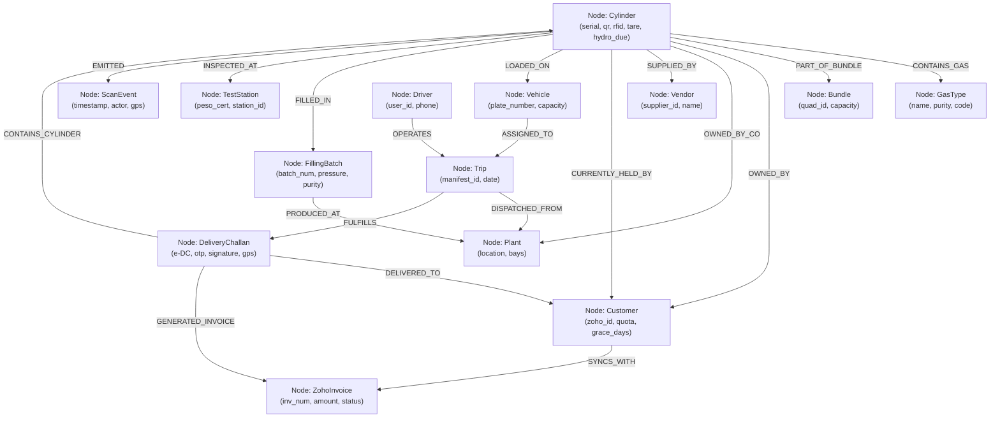
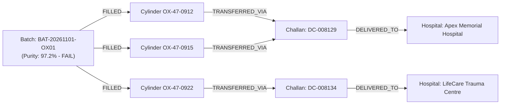

# System Understanding & Enterprise Knowledge Graph
## Domain Conceptualization, Ontology Specification & Graph Schema

---

## 1. Domain Understanding & Core Conceptual Model

Managing high-pressure gas cylinders requires modeling a unique intersection of **physical asset tracking**, **chemical inventory**, **statutory safety governance**, and **dynamic financial billing**.

```
+--------------------------------------------------------------------------------------------------+
|                                    THE CTMS DOMAIN TRIAD                                         |
+--------------------------------------------------------------------------------------------------+
|                                                                                                  |
|              1. THE CONTAINER                         2. THE PRODUCT                             |
|         (Reusable Serialized Asset)               (Consumable Gas Volume)                        |
|        • 30-40 Year Metal Shell                  • Oxygen, Argon, Nitrogen, CO2                  |
|        • High-Pressure Vessel (150-300 Bar)      • Measured in m³, kg, or Litres                 |
|        • Stamped Serial, Tare Weight, PESO       • Depleted upon customer usage                  |
|                      \                               /                                           |
|                       \                             /                                            |
|                        v                           v                                             |
|                                3. THE CUSTODIAN                                                  |
|                            (Location & Responsibility)                                           |
|                           • Plant Yard (Empty / Filling)                                         |
|                           • Delivery Vehicle (In Transit)                                        |
|                           • Customer Premises (Holding)                                          |
|                           • Hydro Test Facility (Maintenance)                                    |
|                                                                                                  |
+--------------------------------------------------------------------------------------------------+
```

### 1.1 Dual-Nature Asset Separation
A fundamental distinction in CTMS is that the **Gas inside the cylinder** and the **Cylinder container itself** operate under separate business models:
1. **The Product (Gas):** Sold as a one-time consumable commodity. Recorded as cost-of-goods-sold (COGS) and inventory reduction in **Zoho Inventory** and invoiced as goods in **Zoho Books**.
2. **The Container (Cylinder Shell):** Bailed to the customer on loan, lease, or deposit. It remains a company capital asset (unless Party-Owned). It accrues holding days and triggers progressive daily rental invoices in **Zoho Books**.

### 1.2 Ownership vs. Custody
The system models ownership independently of physical location:
- **Ownership:** Immutable legal right (`COC` Company-Owned, `POC` Party/Customer-Owned, `VOC` Vendor-Owned).
- **Custody:** Ephemeral physical possession tracked via real-time scan events (`Plant`, `Truck`, `CustomerSite`, `TestingFacility`).
- **Invariant:** A customer holding a `POC` cylinder holds their own asset (zero rental). A customer holding a `COC` cylinder holds company property under bailment (grace period applies; over-holding charges accumulate).

---

## 2. Enterprise Knowledge Graph (Ontology & Topology)

The Knowledge Graph models entities as **Nodes (Vertices)** and operations/relationships as **Edges (Directed Predicates)** with rich temporal properties.



---

## 3. Node & Edge Schema Specification

### 3.1 Core Node Types (Vertices)

| Node Label | Identifying Key | Key Properties | Domain Role |
| :--- | :--- | :--- | :--- |
| `:Cylinder` | `serial_number` | `qr_code_uid`, `rfid_epc_uid`, `stamped_tare_weight_kg`, `hydro_test_due_date`, `status` | The atomic physical pressurized asset container. |
| `:GasType` | `gas_code` | `name`, `chemical_formula`, `standard_purity_pct`, `peso_color_body`, `peso_color_shoulder` | Standard gas commodity specification. |
| `:Bundle` | `bundle_code` | `bundle_type` (QUAD_16, PALLET), `capacity`, `working_pressure` | Grouped transport/manifold handling unit. |
| `:Customer` | `zoho_contact_id`| `company_name`, `gstin`, `credit_quota`, `grace_days`, `active_deposit_balance` | Commercial client holding cylinders and paying bills. |
| `:Plant` | `plant_code` | `name`, `geo_fence`, `peso_license_number`, `active_manifold_bays` | Bottling, testing, and central depot facility. |
| `:Vehicle` | `registration_no`| `make_model`, `carrying_capacity_cylinders`, `rc_expiry` | Transport flatbed or delivery truck. |
| `:Driver` | `employee_id` | `full_name`, `phone_number`, `assigned_vehicle` | Delivery personnel operating the mobile Android app. |
| `:Trip` | `trip_number` | `departure_time`, `return_time`, `closing_discrepancy_count` | Route manifest containing multiple delivery stops. |
| `:DeliveryChallan`| `challan_number`| `challan_type` (DELIVERY/PICKUP), `gps_lat`, `gps_lng`, `otp_code`, `signature_hash` | Non-repudiable transfer document (e-DC / ECR). |
| `:FillingBatch`| `batch_number` | `manifold_id`, `actual_pressure_bar`, `tested_purity_pct`, `lab_report_url` | Production manifold filling cycle with safety QA. |
| `:TestStation` | `peso_station_id`| `station_name`, `license_valid_until`, `accreditation_body` | Certified hydrostatic stretch testing facility. |
| `:ZohoSalesOrder`| `zoho_salesorder_id`| `salesorder_number`, `order_status`, `inward_cylinders_count` | **Cylinder IN:** Inward refill intake & customer empty returns. |
| `:ZohoInvoice` | `zoho_invoice_id`| `invoice_number`, `total_amount`, `payment_status`, `is_rental_invoice` | **Cylinder OUT:** Outward filled cylinder dispatches & gas sales. |
| `:ZohoStockDeliveryChallan`| `zoho_delivery_challan_id`| `delivery_challan_number`, `challan_type`, `deposit_ref` | **Cylinder on Security/Rent:** Returnable asset custody under GST Rule 55. |
| `:ScanEvent` | `event_id` | `event_type`, `from_status`, `to_status`, `timestamp`, `actor_id` | Immutable append-only audit trail element. |

---

### 3.2 Directed Predicates & Edges (Relationships)

```
+---------------------------------------------------------------------------------------------------+
| Edge Predicate              | Source Node        | Target Node        | Edge Properties           |
+-----------------------------+--------------------+--------------------+---------------------------+
| `CONTAINS_GAS`              | :Cylinder          | :GasType           | `pressure_bar`, `fill_dt` |
| `OWNED_BY_CUSTOMER` (POC)   | :Cylinder          | :Customer          | `registration_date`       |
| `OWNED_BY_COMPANY` (COC)    | :Cylinder          | :Plant             | `capitalization_value`    |
| `HELD_BY`                   | :Cylinder          | :Customer          | `held_since`, `days_held`,|
|                             |                    |                    | `rental_accrued_inr`      |
| `LOADED_ON`                 | :Cylinder          | :Vehicle           | `loaded_at`, `gate_pass`  |
| `TRANSFERRED_UNDER`         | :Cylinder          | :DeliveryChallan   | `item_condition`, `photo` |
| `FILLED_IN_BATCH`           | :Cylinder          | :FillingBatch      | `tare_deviation_pct`      |
| `TESTED_AT`                 | :Cylinder          | :TestStation       | `hydro_test_date`, `cert` |
| `AUDITED_BY_EVENT`          | :Cylinder          | :ScanEvent         | `sequence_order`          |
| `DISPATCHED_IN_TRIP`        | :DeliveryChallan   | :Trip              | `stop_order_index`        |
| `ORDERED_INWARD_AS`         | :DeliveryChallan   | :ZohoSalesOrder    | `intake_timestamp`        |
| `BILLED_OUTWARD_AS`         | :DeliveryChallan   | :ZohoInvoice       | `sync_timestamp`          |
| `BAILED_ON_RENT_OR_DEPOSIT` | :DeliveryChallan   | :ZohoStockDeliveryChallan | `gst_rule_55_ref`  |
+---------------------------------------------------------------------------------------------------+
```

---

## 4. Dgraph DQL Schema Definition (GraphQL+-)

For high-throughput graph queries, graph-based analytics, and supply-chain fraud detection, the knowledge graph schema is defined in **Dgraph DQL**:

```graphql
# Dgraph Schema Directives for CTMS Knowledge Graph

type Cylinder {
    serial_number: string @index(exact, term) .
    qr_code_uid: string @index(exact) .
    rfid_epc_uid: string @index(exact) .
    ownership: string @index(exact) .
    stamped_tare_weight_kg: float .
    current_tare_weight_kg: float .
    hydro_test_due_date: datetime @index(day) .
    status: string @index(exact) .
    contains_gas: uid .
    held_by: uid @reverse .
    loaded_on: uid @reverse .
    part_of_bundle: uid @reverse .
    history_events: [uid] @reverse .
}

type Customer {
    zoho_contact_id: string @index(exact) .
    company_name: string @index(term, trigram) .
    gstin: string @index(exact) .
    credit_quota: int .
    free_grace_days: int .
    holds_cylinders: [uid] .
    challans_received: [uid] @reverse .
    invoices: [uid] @reverse .
}

type DeliveryChallan {
    challan_number: string @index(exact) .
    challan_type: string @index(exact) .
    delivery_timestamp: datetime @index(hour) .
    delivered_to: uid .
    dispatched_in: uid .
    delivered_cylinders: [uid] .
    collected_cylinders: [uid] .
    signature_url: string .
    zoho_invoice: uid @reverse .
}

type FillingBatch {
    batch_number: string @index(exact) .
    gas_type: uid .
    filling_plant: uid .
    actual_pressure_bar: float .
    purity_percentage: float .
    completed_at: datetime @index(day) .
    cylinders_in_batch: [uid] .
}

type ScanEvent {
    event_type: string @index(exact) .
    timestamp: datetime @index(day) .
    actor_id: string @index(exact) .
    from_status: string .
    to_status: string .
    geo_point: geo .
}
```

---

## 5. Critical Graph Query Patterns & Traversals

### Query Pattern 1: Complete 360-Degree Cylinder Lifecycle Traversal
*Question: "Show the complete 12-month journey of cylinder AR-47-0912: every customer held, trip driven, and test undergone."*

```graphql
{
  cylinder_trace(func: eq(serial_number, "AR-47-0912")) {
    serial_number
    status
    hydro_test_due_date
    contains_gas {
      gas_code
      name
    }
    held_by {
      company_name
      zoho_contact_id
    }
    ~delivered_cylinders (orderdesc: delivery_timestamp) {
      challan_number
      delivery_timestamp
      dispatched_in {
        trip_number
        assigned_driver {
          full_name
        }
      }
      delivered_to {
        company_name
      }
    }
    history_events (orderdesc: timestamp, first: 50) {
      event_type
      timestamp
      from_status
      to_status
      actor_id
    }
  }
}
```

---

### Query Pattern 2: Contamination & Medical Batch Recall Traversal
*Question: "A purity defect was detected in Medical Oxygen Filling Batch BAT-20261101-OX01. Identify every hospital, delivery challan, and active cylinder connected to this batch for immediate emergency quarantine."*



#### DQL Traversal:
```graphql
{
  batch_recall(func: eq(batch_number, "BAT-20261101-OX01")) {
    batch_number
    actual_pressure_bar
    purity_percentage
    cylinders_in_batch {
      serial_number
      status
      ~delivered_cylinders {
        challan_number
        delivery_timestamp
        delivered_to {
          company_name
          contact_person
          phone
        }
      }
    }
  }
}
```

---

### Query Pattern 3: Unreturned Cylinder Hoarding & Rental Exposure Subgraph
*Question: "Identify all customers currently holding cylinders past their contracted grace days, along with the accumulated holding duration and projected invoice amount for Zoho Books."*

```graphql
{
  hoarding_exposure(func: type(Customer)) @filter(gt(holds_cylinders, 0)) {
    company_name
    zoho_contact_id
    credit_quota
    free_grace_days
    holds_cylinders @filter(eq(ownership, "COC")) {
      serial_number
      contains_gas {
        gas_code
      }
      # Calculate days held by traversing delivery challan timestamp
      ~delivered_cylinders (first: 1, orderdesc: delivery_timestamp) {
        delivery_timestamp
      }
    }
  }
}
```

---

### Query Pattern 4: Logistics Discrepancy & Shrinkage Detection Traversal
*Question: "Locate where cylinder loss occurred across truck dispatch, delivery confirmations, and gate check-in."*

```mermaid
graph TD
    GatePass["Gate Outward Scan<br/>(120 Cylinders on Truck)"] -->|MATCHED| Manifest["Delivery Manifest (Trip 09)"]
    Manifest -->|DELIVERED (90)| CustDrop["Customer Drops Confirmed via e-DC"]
    Manifest -->|RETAINED (30)| TruckClosing["Remaining on Truck"]
    Manifest -->|COLLECTED (80)| Empties["Collected Empties via ECR"]
    
    CustDrop --> Audit{"Gate Return Inward Audit"}
    TruckClosing --> Audit
    Empties --> Audit
    
    Audit -->|VERIFIED 106| Passed["106 Verified Safe"]
    Audit -->|DELTA -4| Discrepancy["4 MISSING ASSETS<br/>Investigate Driver & Route Stops"]
```

---

## 6. Synergies Between the Relational DB & the Knowledge Graph

CTMS leverages a **Hybrid Polyglot Architecture**:
1. **PostgreSQL 16 + TimescaleDB:** Serves as the transactional operational source of truth (ACID writes, constraints, foreign keys, outbox queues).
2. **Knowledge Graph (Dgraph / Neo4j / Graph Views):** Serves as the analytical and traversal engine for fast pathfinding (contamination trace, dispute resolution, asset circulation networks, and Zoho relationship synchronization).
